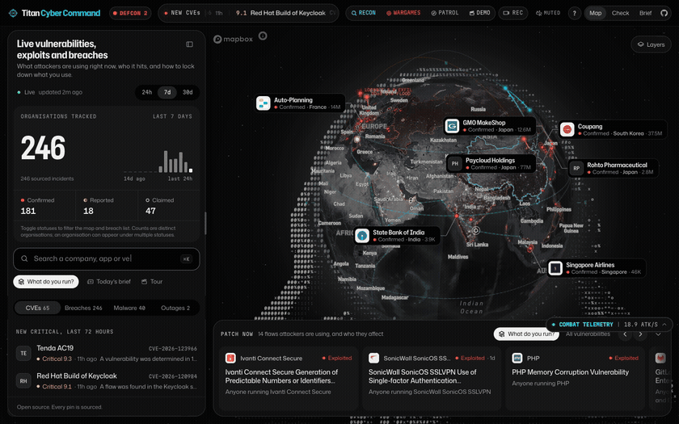

# Titan Cyber Command

<p align="center">
  <a href="https://titan-cybercommand.vercel.app">
    
  </a>
  <a href="https://github.com/enabled404/titan-cybercommand">
    
  </a>
  <a href="https://github.com/enabled404/titan-cybercommand">
    
  </a>
  <a href="https://github.com/enabled404/titan-cybercommand">
    
  </a>
  <a href="LICENSE">
    
  </a>
</p>

**Global Kinetic Cyber Warfare & Real-Time Threat Intelligence Command Center**

[](https://titan-cybercommand.vercel.app)

🎥 **[Watch Master 1080p Briefing Video (MP4 with Synth Audio)](docs/demo.mp4)** | 🌐 **[VP9 WebM Master](docs/demo.webm)**

Every cyber assault, ransomware breach, zero-day exploit, and network outage on Earth, tracked in real-time across an interactive 3D globe. Powered by true spherical Great-Circle geodesic trajectory mathematics, live streaming combat telemetry, procedural Web Audio synthesis, physical subsea fiber infrastructure, interactive disaster simulation, and non-invasive domain reconnaissance.

---

## Breakthrough Capabilities

- **True Great-Circle Ballistic Particle Engine**: Real-time laser trajectories calculated using spherical geodesics (`@turf/great-circle`) arcing through the exosphere from global threat actor command hubs (APT28, Volt Typhoon, Lazarus, Charming Kitten) to victim targets. Features chromatic plasma comet heads, drifting spark particles, and concentric ground shockwaves with detonation flashes.
- **Live Combat Intercept Feed (`T`)**: Collapsible real-time telemetry drawer streaming incoming intercepts, origin vectors, victim organizations, severity ratings, and live velocity calculations (e.g. `18.4+ ATK/S`).
- **Orbital Telemetry HUD Reticle**: High-tech vector optical reticle enclosing the 3D globe with 360-degree compass degree tick marks, cardinal direction indicators (N, E, S, W), rotating radar sweep arm with cyan phosphor glow, and center targeting gimbal crosshairs.
- **Cinematic Auto-Patrol Camera (`P` / `C`)**: Automated slow-orbit patrol view continuously rotating the globe for command center video wall displays and briefings.
- **Target Recon Passive Scanner (`R`)**: Enter any domain (e.g. `tesla.com`, `apple.com`, or your company) to execute non-invasive OSINT reconnaissance: DNS routing, MX security, SPF/DMARC spoof defense, ransomware leak site exposures, and active CVE correlations with an automated Threat Posture rating (A+ to F).
- **WarGames Cascading Disaster Simulator (`W`)**: Interactive simulation engine testing catastrophic scenarios including subsea fiber optic cable severance, global cloud hypervisor panic, and SCADA electrical grid infiltration with automated countermeasure deployment.
- **STIX 2.1 Threat Intel Export**: One-click export of machine-readable STIX 2.1 JSON indicators of compromise (IoCs) and formatted Markdown dossiers for direct ingestion into enterprise SIEMs (Splunk, Microsoft Sentinel, Elastic).
- **In-App Demo Video Briefing (`V`)**: Watch the high-definition master briefing video embedded directly in the application or download full 1080p MP4, animated GIF, or WebM masters with one click.
- **Procedural DEFCON Audio Synthesizer (`M`)**: Built entirely on the Web Audio API with zero external audio downloads. Features a 55Hz sub-bass tactical reactor drone, stereo-panned laser swooshes, impact thuds, terminal relay clicks, and dual-frequency alert chimes.
- **Submarine Internet Cables Layer**: Physical infrastructure layer rendering global deep-sea fiber optic cables (MAREA, Dunant, Grace Hopper, SEA-ME-WE 5, FASTER, 2Africa) directly on the ocean floor.
- **In-App 1-Click Demo Recorder**: Built-in canvas capture engine allowing operators to record and download smooth 60fps HD video clips directly from their browser.
- **New CVEs & CISA KEV**: Real-time ticker and index at `/cve` of critical CVEs published in the last 72 hours and flaws CISA confirmed actively exploited.
- **Patch Now Dock**: Software currently weaponized by attackers today, explaining what can happen, who is affected, and what fixes it.
- **Am I Affected?**: Select the apps, packages, and companies you use to see what attackers are exploiting in them.
- **Agent Runbooks & MCP Server**: One-click runbooks for Claude Code, Codex, and Cursor, plus a read-only Model Context Protocol (MCP) server at `/api/mcp` and `llms.txt`.

---

## Tactical Operator Hotkeys

| Key | Operation |
| :--- | :--- |
| `W` | Launch WarGames Cascading Disaster Simulator |
| `R` | Launch Target Recon Passive OSINT Scanner |
| `V` | Watch Master Demo Briefing Video & Export Artifacts |
| `P` / `C` | Toggle Cinematic Auto-Patrol / Command View |
| `T` | Toggle Live Combat Intercept Telemetry Drawer |
| `M` | Toggle Procedural DEFCON Sound Synthesizer |
| `J` / `K` | Step Forward / Backward Through Live Threat Dossiers |
| `Space` | Center Globe on Next Active Threat Blip |
| `Esc` | Clear Active Dossier or Dismiss Open Modal |
| `?` | Display Keybindings Reference Guide |

---

## Status, Honestly

| Status | Means |
| :--- | :--- |
| Confirmed | Acknowledged by the organisation, a regulator or a filing |
| Reported | Covered by the press, not yet confirmed by the organisation |
| Claimed | Asserted by attackers on a leak site, unverified |
| Precautionary | Systems taken offline as a precaution, no compromise stated |
| Disputed | Reported, and denied by the organisation |

*An absent result is never proof that you are safe.*

---

## Legal, Rights & Security Protections

Titan Cyber Command is built strictly for defensive cybersecurity education and research:

- [Security Policy & Safe Harbor](SECURITY.md): Responsible vulnerability disclosure guidelines, researcher legal safe-harbor, and reporting channels.
- [Terms of Service & Safe Harbor](https://titan-cybercommand.vercel.app/terms): Defensive research purpose, CFAA compliance, Fair Use (17 U.S.C. § 107), non-affiliation, and limitation of liability ([source](src/app/terms/page.tsx)).
- [Privacy Policy](https://titan-cybercommand.vercel.app/privacy): Zero-log policy for target lookups, client-side only preference caching, and ethical OSINT compliance ([source](src/app/privacy/page.tsx)).
- [Threat Intelligence Disclaimer](DISCLAIMER.md): Explicit distinction between verified disclosures and unverified dark-web claims.
- [Legal Framework](LEGAL.md): Defensive scope, regulatory alignment, and third-party registry notices.

---

## Run Locally

Requires Node 20+ and pnpm.

```bash
pnpm install
cp .env.example .env.local   # fill in what you have
pnpm dev
```

Open `http://localhost:3000`.

To build for production:
```bash
pnpm build
pnpm start
```

---

## Quality & Development Verification

```bash
pnpm exec tsc --noEmit
pnpm exec eslint src
pnpm exec vitest run
```

---

## Acknowledgement & Inspiration

Titan Cyber Command was built upon the design foundation and initial data pipeline architecture of [yorkeccak/globalhackmap](https://github.com/yorkeccak/globalhackmap), completely re-engineered, modernized, and expanded with real-time ballistic particle physics, procedural audio, physical subsea infrastructure, interactive disaster simulation, in-app video recording, and target reconnaissance.

---

## License

Code: MIT (see [LICENSE](LICENSE)). Fonts in `src/assets/fonts` are under the SIL Open Font License.
